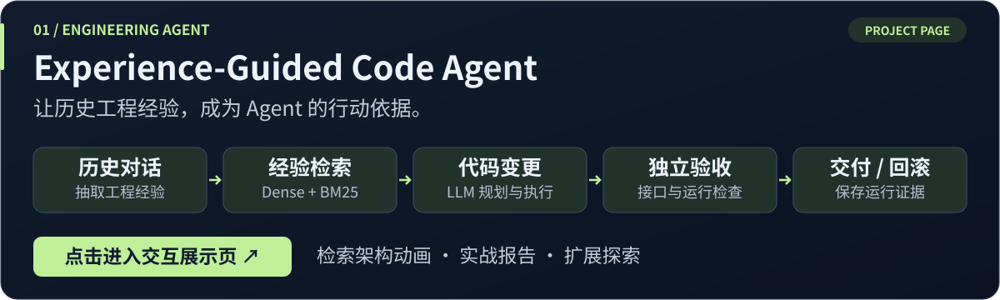
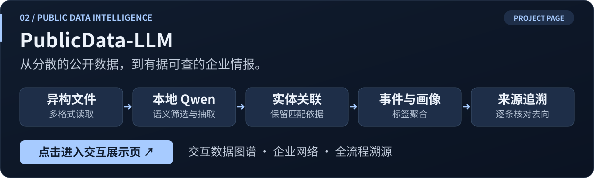
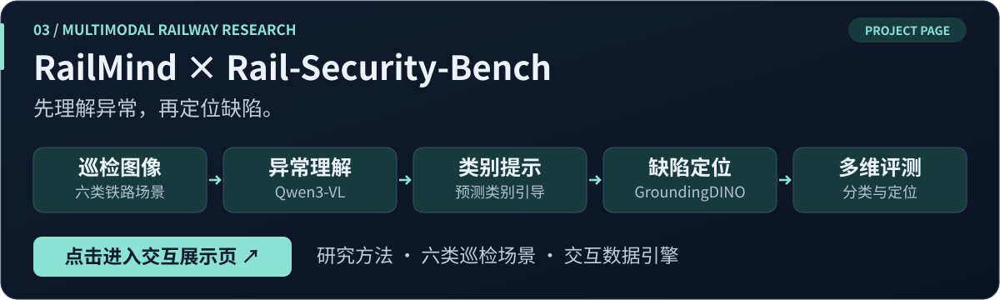

# Hi, I'm Chao Ma 👋 · 马超

**北京交通大学 · 人工智能硕士在读 · 2027 届**  
**LLM / VLM Post-training · AI Agents · Data Engineering**

我关注多模态大模型、模型后训练与 AI Agent，围绕真实业务中的代码变更、公共数据理解和铁路异常巡检，构建从数据准备、模型适配到执行验证的完整流程。

## 🚀 进入我的交互展示页

**点击下方任意卡片，查看项目演示、方法图解与结果。**

<a href="https://chaomacv.github.io/experience-guided-code-agent/">
<picture>
  <source media="(max-width: 640px)" srcset="assets/showcase/code-agent-mobile.svg">
  
</picture>
</a>

**[进入 Experience-Guided Code Agent 展示页 ↗](https://chaomacv.github.io/experience-guided-code-agent/)**

<a href="https://chaomacv.github.io/public-data-llm/">
<picture>
  <source media="(max-width: 640px)" srcset="assets/showcase/public-data-mobile.svg">
  
</picture>
</a>

**[进入 PublicData-LLM 展示页 ↗](https://chaomacv.github.io/public-data-llm/)**

<a href="https://chaomacv.github.io/RAIL-SECURTTY-BENCH/">
<picture>
  <source media="(max-width: 640px)" srcset="assets/showcase/railmind-mobile.svg">
  
</picture>
</a>

**[进入 RailMind × Rail-Security-Bench 展示页 ↗](https://chaomacv.github.io/RAIL-SECURTTY-BENCH/)**

---

## 🛠️ 代表项目

### [Experience-Guided Code Agent](https://github.com/chaomacv/experience-guided-code-agent)

**让历史工程经验成为代码变更的行动依据。** 从人机对话中抽取可追溯的工程经验，通过混合检索增强 LLM 规划，完成代码修改、独立验收、失败重试与回滚，并交付代码、Patch 和运行证据。

`Python` `RAG` `BGE-M3 + BM25` `LLM Planning` `Validation & Rollback`

**[▶ 进入交互展示页](https://chaomacv.github.io/experience-guided-code-agent/)** · [源码与复现](https://github.com/chaomacv/experience-guided-code-agent#quick-start)

### [PublicData-LLM](https://github.com/chaomacv/public-data-llm)

**把海量异构公开数据转化为有来源证据的企业事件与画像。** 结合本地 Qwen、规则处理与实体关联，完成文件筛选、结构化抽取、标签聚合和来源追溯。公开工程最新批次为约 **4,365 万条**已知记录建立处理或排除台账，汇总约 **597 万条事件观察、18 个类别**，并保留待复核项。

`Python` `Qwen3-8B` `DuckDB` `Entity Resolution` `Data Lineage`

**[▶ 进入交互展示页](https://chaomacv.github.io/public-data-llm/)** · [批次结果与统计口径](https://github.com/chaomacv/public-data-llm/blob/main/docs/full_run_results.md)

### [RailMind](https://github.com/chaomacv/RailMind)

**先理解异常，再定位缺陷。** 使用 Qwen3-VL 识别铁路巡检图像中的异常类别与视觉证据，再以预测类别引导 GroundingDINO 定位；研究流程涵盖教师监督、合成数据增强、SFT 及可选 GRPO / GSPO 后训练。

`Qwen3-VL` `GroundingDINO` `SFT` `GRPO / GSPO` `Multimodal Reasoning`

**[▶ 进入研究展示页](https://chaomacv.github.io/RAIL-SECURTTY-BENCH/)** · [方法与代码](https://github.com/chaomacv/RailMind)

### [Rail-Security-Bench](https://github.com/chaomacv/RAIL-SECURTTY-BENCH)

**面向铁路基础设施安全的多模态异常理解与定位评测。** 覆盖钢桥、声屏障、周边环境、电力塔、轨道和接触网支柱六类巡检场景，提供研究展示、评测介绍及交互式数据引擎。

**[▶ 查看 Benchmark 展示](https://chaomacv.github.io/RAIL-SECURTTY-BENCH/)** · **[体验交互式数据引擎 ↗](https://chaomacv.github.io/RAIL-SECURTTY-BENCH/data-engine/)**

## 💼 实习经历

- **华为技术有限公司 · AI 技术应用**｜2026.06 – 2026.08  
  围绕算法模块替换，设计历史经验 RAG、Skill 与执行验证流程，实现接口一致性检查、编译运行验证和失败反馈修正。实习业务中，对照历史同类任务，平均人工交互由约 **24 轮降至 15 轮（减少 37.5%）**。

- **兴业银行北京分行 · 数据开发岗**｜2026.02 – 2026.04  
  面向企业风险分析与精准获客场景，设计规则与 LLM 协同的公共数据处理流程，完成异构文件筛选、结构化抽取、企业实体关联、画像标签与来源追溯。

- **中国铁道科学研究院 · 人工智能科研岗**｜2025.09 – 2026.01  
  研发铁路多模态推理与视觉定位 Agent，开展领域知识蒸馏、合成数据增强与模型后训练；构建 **20,931 条 SFT 样本、3,134 条 RL Prompt 和 10,613 个实例级边界框标注**。相关成果以第一作者投稿 IEEE 期刊，审稿中。

## 🔬 技术方向

| 方向 | 技术与实践 |
| --- | --- |
| 大模型与后训练 | Transformer、LLM / VLM、SFT、LoRA、GRPO / GSPO、知识蒸馏、合成数据增强与奖励设计 |
| Agent 与 RAG | 多模态 Agent、Coding Agent、Embedding、混合检索、任务规划、工具调用、Skill、自动验收与回滚 |
| 数据与评测 | 异构数据处理、实体关联、来源追溯、训练数据构建、自动标注、Benchmark 与实验分析 |
| 编程与工程 | Python、PyTorch、C / C++、Linux、多 GPU 训练、复杂 Pipeline 调试与算法集成 |

## 🎓 教育背景

- **北京交通大学 · 计算机科学与技术学院**  
  人工智能（电子信息）硕士｜2024.09 – 至今｜2027 届
- **北京交通大学 · 计算机科学与技术学院**  
  计算机科学与技术本科｜2020.09 – 2024.06

## 📫 联系我

[24125336@bjtu.edu.cn](mailto:24125336@bjtu.edu.cn) · [GitHub @chaomacv](https://github.com/chaomacv)
