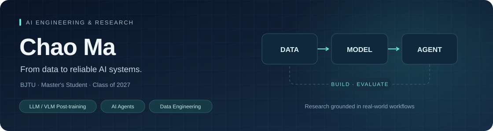

  

<h1 align="center">马超 · Chao Ma</h1>

  <strong>北京交通大学 · 人工智能硕士在读 · 2027 届</strong> 
  多模态大模型 / 模型后训练 / AI Agent

  
  

我关注多模态大模型、模型后训练与 AI Agent，围绕真实业务中的代码变更、公共数据理解和铁路异常巡检，构建从数据准备、模型适配到执行验证的完整流程。

  
  
  
  
  
  

## 01 / 代表项目

<table>
<tr>
<td width="50%" valign="top">
<h3>Experience-Guided Code Agent</h3>

<strong>让历史工程经验成为代码变更的行动依据。</strong>

从人机对话中抽取可追溯的工程经验，通过混合检索增强 LLM 规划，完成代码修改、独立验收、失败重试与回滚，并交付代码、Patch 和运行证据。

<code>Python</code> <code>RAG</code> <code>BGE-M3 + BM25</code> <code>LLM Planning</code> <code>Validation &amp; Rollback</code>

</td>
<td width="50%" valign="top">
<h3>PublicData-LLM</h3>

<strong>把异构公开数据转化为有来源证据的企业画像。</strong>

结合本地 Qwen、规则处理与实体关联，完成文件筛选、结构化抽取、标签聚合和来源追溯。公开工程最新批次为约 <strong>4,365 万条</strong>已知记录建立处理或排除台账，汇总约 <strong>597 万条事件观察、18 个类别</strong>，并保留待复核项。

<code>Python</code> <code>Qwen3-8B</code> <code>DuckDB</code> <code>Entity Resolution</code> <code>Data Lineage</code>

</td>
</tr>
<tr>
<td width="50%" valign="bottom">

<a href="https://chaomacv.github.io/experience-guided-code-agent/"><strong>交互展示 ↗</strong></a> · <a href="https://github.com/chaomacv/experience-guided-code-agent#quick-start">源码与复现</a>

</td>
<td width="50%" valign="bottom">

<a href="https://chaomacv.github.io/public-data-llm/"><strong>交互展示 ↗</strong></a> · <a href="https://github.com/chaomacv/public-data-llm">源码</a> · <a href="https://github.com/chaomacv/public-data-llm/blob/main/docs/full_run_results.md">统计口径</a>

</td>
</tr>
<tr>
<td width="50%" valign="top">
<h3>RailMind</h3>

<strong>先理解异常，再定位缺陷。</strong>

使用 Qwen3-VL 识别铁路巡检图像中的异常类别与视觉证据，再以预测类别引导 GroundingDINO 定位；研究流程涵盖教师监督、合成数据增强、SFT 及可选 GRPO / GSPO 后训练。

<code>Qwen3-VL</code> <code>GroundingDINO</code> <code>SFT</code> <code>GRPO / GSPO</code> <code>Multimodal Reasoning</code>

</td>
<td width="50%" valign="top">
<h3>Rail-Security-Bench</h3>

<strong>面向铁路基础设施安全的多模态评测。</strong>

聚焦异常理解与定位，覆盖钢桥、声屏障、周边环境、电力塔、轨道和接触网支柱六类巡检场景，提供研究展示、评测介绍及交互式数据引擎。

<code>Benchmark</code> <code>Visual Grounding</code> <code>Railway Inspection</code> <code>Data Engine</code>

</td>
</tr>
<tr>
<td width="50%" valign="bottom">

<a href="https://chaomacv.github.io/RAIL-SECURTTY-BENCH/"><strong>研究展示 ↗</strong></a> · <a href="https://github.com/chaomacv/RailMind">方法与代码</a>

</td>
<td width="50%" valign="bottom">

<a href="https://chaomacv.github.io/RAIL-SECURTTY-BENCH/"><strong>Benchmark 展示 ↗</strong></a> · <a href="https://chaomacv.github.io/RAIL-SECURTTY-BENCH/data-engine/">数据引擎</a> · <a href="https://github.com/chaomacv/RAIL-SECURTTY-BENCH">源码</a>

</td>
</tr>
</table>

## 02 / 实习经历

| 时间 | 公司 / 岗位 | 工作重点 |
| --- | --- | --- |
| 2026.06 – 2026.08 | **华为** · AI 技术应用 | 历史经验 RAG、算法升级与执行验证 |
| 2026.02 – 2026.04 | **兴业银行北京分行** · 数据开发岗 | 公共数据处理、企业实体关联与画像 |
| 2025.09 – 2026.01 | **中国铁道科学研究院** · 人工智能科研岗 | 多模态推理、视觉定位与模型后训练 |

<strong>展开：工作内容与量化成果</strong>

- **华为技术有限公司 · AI 技术应用**｜2026.06 – 2026.08  
  围绕算法模块替换，设计历史经验 RAG、Skill 与执行验证流程，实现接口一致性检查、编译运行验证和失败反馈修正。实习业务中，对照历史同类任务，平均人工交互由约 **24 轮降至 15 轮（减少 37.5%）**。

- **兴业银行北京分行 · 数据开发岗**｜2026.02 – 2026.04  
  面向企业风险分析与精准获客场景，设计规则与 LLM 协同的公共数据处理流程，完成异构文件筛选、结构化抽取、企业实体关联、画像标签与来源追溯。

- **中国铁道科学研究院 · 人工智能科研岗**｜2025.09 – 2026.01  
  研发铁路多模态推理与视觉定位 Agent，开展领域知识蒸馏、合成数据增强与模型后训练；构建 **20,931 条 SFT 样本、3,134 条 RL Prompt 和 10,613 个实例级边界框标注**。相关成果以第一作者投稿 IEEE 期刊，审稿中。

## 03 / 技术与实践

**模型** — LLM / VLM · SFT / LoRA · GRPO / GSPO · 知识蒸馏  
**智能体** — RAG / 混合检索 · 工具调用 · 自动验收与回滚  
**工程** — Python / PyTorch · C / C++ · Linux · 数据管线与评测

<strong>展开：完整技术栈</strong>

| 方向 | 技术与实践 |
| --- | --- |
| 大模型与后训练 | Transformer、LLM / VLM、SFT、LoRA、GRPO / GSPO、知识蒸馏、合成数据增强与奖励设计 |
| Agent 与 RAG | 多模态 Agent、Coding Agent、Embedding、混合检索、任务规划、工具调用、Skill、自动验收与回滚 |
| 数据与评测 | 异构数据处理、实体关联、来源追溯、训练数据构建、自动标注、Benchmark 与实验分析 |
| 编程与工程 | Python、PyTorch、C / C++、Linux、多 GPU 训练、复杂 Pipeline 调试与算法集成 |

## 04 / 教育背景

- **北京交通大学 · 计算机科学与技术学院**  
  人工智能（电子信息）硕士｜2024.09 – 至今｜2027 届
- **北京交通大学 · 计算机科学与技术学院**  
  计算机科学与技术本科｜2020.09 – 2024.06

---

  <strong>欢迎交流 AI Agent、多模态模型与工程实践</strong> 
  <a href="mailto:24125336@bjtu.edu.cn">24125336@bjtu.edu.cn</a> · <a href="https://github.com/chaomacv">GitHub @chaomacv</a>

